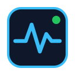
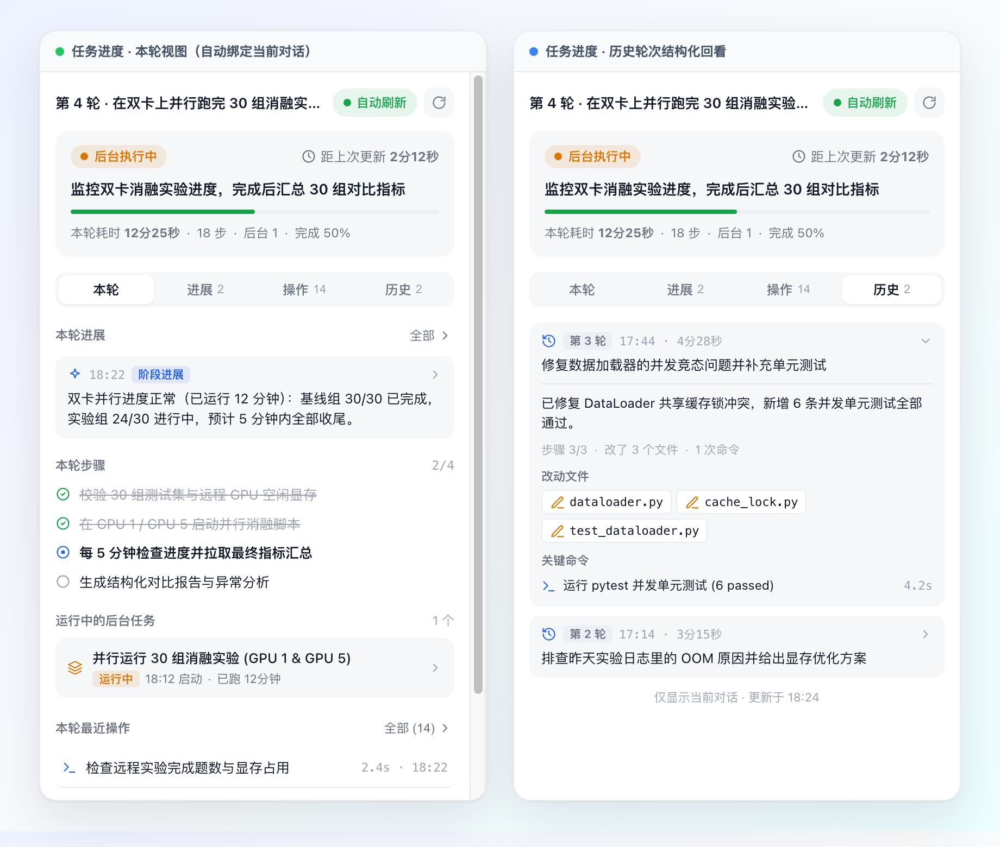

<div align="center">



# Antigravity Task Monitor

**为 Google Antigravity 2.0 打造的「任务进度看板」插件 · 严格会话隔离 · 长任务智能分级回报**

*A clean, session-isolated Google Antigravity 2.0 sidebar & global monitor plugin that tracks current-turn steps, Chinese-first stage updates, background jobs, and structured turn history—with adaptive check-in rules (two 5-min stability checks, then milestone-only reporting).*

[](https://github.com/MDHan/antigravity-task-monitor)
[](https://github.com/MDHan/antigravity-task-monitor)
[](https://github.com/MDHan/antigravity-task-monitor)
[](LICENSE)

[界面预览](#preview) · [核心特性](#features) · [快速安装](#install) · [使用说明](#usage) · [目录结构](#structure) · [English Guide](#english-guide)

</div>

---

<a id="preview"></a>
## ✨ 界面预览（Visual Showcase）

浅色 / 深色主题自动跟随 Antigravity 客户端，左侧展示**本轮任务实时视图**（自动绑定当前对话），右侧展示**历史轮次结构化回看**（含结果摘要、去重改动文件标签与关键命令）：



---

<a id="features"></a>
## ✨ 核心特性（Features）

- **自动跟随当前对话，严格会话隔离**：
  - 右侧边栏采用 Antigravity 原生 Sidecar（`SIDECAR_UI_ENTRYPOINT_AUX_PANE`），点开哪个对话就自动绑定哪个对话，绝不串台、无需手动切换。
  - 同时在左侧全局导航栏提供 **「任务总览」** 入口（MCP App），需要跨对话统一巡检时一键直达。
- **主次分明：首页只看「本轮」，过往收进「历史」**：
  - **本轮**：顶部状态卡一目了然展示状态胶囊、**距上次更新时间**、当前焦点、进度条与**本轮耗时**；下方依次呈现本轮进展、本轮步骤、运行中的后台任务和本轮最近操作，不被几小时前的历史数据干扰。
  - **进展**：优先展示按用户语言（如中文）生成的**阶段进展与结论**，并支持一键切换查看模型内部英文思考原文。
  - **操作**：按时间倒序呈现本轮所有操作记录，配统一线性 SVG 图标，支持按「命令 / 修改 / 读取 / 报错」胶囊筛选及关键词搜索，点击展开完整命令或文件路径。
  - **历史**：将本对话之前的轮次按轮折叠收纳，点开即见该轮的结果摘要、去重改动文件标签、关键命令及耗时。
- **长任务智能分级回报（`rules/AGENTS.md`，省 Token 又安心）**：
  - 任务刚启动时，在第 **5 分钟** 和第 **10 分钟** 各做一次快速稳态检查（确认进程存活、显存与产出正常）；
  - 连续两次稳定后自动切入**关键节点模式**（按预估进度在阶段完成/收尾前汇报，最长 20~30 分钟兜底），相比高频轮询节省约 70% 的巡检 Token 消耗。
- **Hooks 实时记录 & 看板零额外 Token 消耗**：
  - 通过 `SessionStart` / `PreInvocation` / `PostInvocation` / `PostToolUse` / `Stop` 本地落盘实时状态，不干扰工具权限弹窗，不弹冗余桌面通知。
  - 看板每 3 秒自动刷新与 Hooks 采集均在本地完成，**0 额外 Token 消耗**。

---

<a id="install"></a>
## 🚀 快速安装（Installation）

### 方式一：一句话让 Antigravity AI 自动安装（最简单 · 推荐）

直接把仓库链接发给 Antigravity，说一句：

```text
https://github.com/MDHan/antigravity-task-monitor 帮我安装一下这个插件
```

AI 会自动克隆到插件目录、安装依赖并验证加载，全程无需手动敲命令。

### 方式二：使用 `agy` CLI 一键安装

```bash
agy plugin install https://github.com/MDHan/antigravity-task-monitor
```

### 方式三：使用 `git clone` 克隆到插件目录

```bash
git clone https://github.com/MDHan/antigravity-task-monitor.git ~/.gemini/config/plugins/task-monitor
cd ~/.gemini/config/plugins/task-monitor/server && npm install
```

### 方式四：手动下载 ZIP

1. 点击本仓库 **Code → Download ZIP** 并解压。
2. 将目录重命名为 `task-monitor`，放入 `~/.gemini/config/plugins/task-monitor/`（确保 `plugin.json` 直接位于该目录下），并在 `server/` 目录执行 `npm install`。

> 安装完成后，Antigravity 会自动发现并加载插件（也可在左侧 **个性化定制 / Customizations** 中确认「任务进度看板」已启用）。

---

<a id="usage"></a>
## 🧭 使用说明（Usage）

1. **查看当前对话实时进度（推荐）**：在任意对话右上角的 **`+`** 菜单中选择 **`任务进度`**，右侧边栏会自动绑定当前对话并每 3 秒刷新。
2. **四个标签页分工**：
   - **`本轮`**：看当前这一次提问的实时状态、距上次更新时长、步骤清单与运行中的后台任务。
   - **`进展`**：回看本轮的中文阶段结论，需要深挖时可点「含内部思考原文」。
   - **`操作`**：按类型筛选或搜索本轮执行过的命令、修改/读取的文件及报错记录，点击展开详情。
   - **`历史`**：按轮次折叠展示本对话之前做过什么，点开看摘要、改动文件与关键命令。
3. **跨对话全局巡检**：点击左侧全局导航栏的 **`任务总览`**，即可切换查看所有近期对话的状态。

---

<a id="structure"></a>
## 📁 目录结构（Project Structure）

```text
antigravity-task-monitor/
├── plugin.json                        # Antigravity 插件清单
├── hooks.json                         # 生命周期事件监听配置
├── mcp_config.json                    # 全局总览 MCP Server 配置
├── LICENSE                            # MIT License
├── README.md                          # 说明文档
├── assets/
│   ├── logo.svg                       # 插件图标
│   └── preview.png                    # 双栏界面预览图
├── rules/
│   └── AGENTS.md                      # 长任务分级回报（稳态确认 + 关键节点）规范
├── hooks/
│   └── record_event.py                # 轻量本地状态采集脚本
├── sidecars/
│   └── monitor_panel/                 # 自动绑定当前对话的右侧边栏 Sidecar
│       ├── sidecar.json
│       ├── package.json
│       ├── main.mjs                   # 按会话 ID 提供本轮与历史状态接口
│       ├── index.html
│       ├── styles.css
│       └── app.js
└── server/
    ├── monitor-core.mjs               # 共享轨迹、轮次与后台任务解析器
    ├── server.mjs                     # 左侧全局「任务总览」MCP Server
    ├── build-ui.mjs                   # 前端单文件打包脚本
    ├── ui-src/app.js                  # 全局面板前端源码
    └── app.html                       # 已打包的单文件全局面板
```

---

<a id="english-guide"></a>
## 🌍 English Guide

### Overview

**Antigravity Task Monitor** is a session-isolated task progress monitor plugin for **Google Antigravity 2.0**. Built for long-running workflows (model training, remote SSH/GPU jobs, multi-step coding), it automatically binds to the active conversation in the right auxiliary pane, separates **current-turn progress** from **structured turn history**, surfaces readable stage summaries, and ships with an adaptive check-in rule (`rules/AGENTS.md`: two 5-min stability checks after launch, then milestone-based reporting to save tokens).

### Quick Install

```bash
# Option 1: Antigravity CLI
agy plugin install https://github.com/MDHan/antigravity-task-monitor

# Option 2: Git Clone
git clone https://github.com/MDHan/antigravity-task-monitor.git ~/.gemini/config/plugins/task-monitor
cd ~/.gemini/config/plugins/task-monitor/server && npm install
```

Open **`任务进度`** from the conversation top-right **`+`** menu for the auto-bound side pane, or **`任务总览`** from the left sidebar for a global overview.

### License

Released under the [MIT License](LICENSE).
